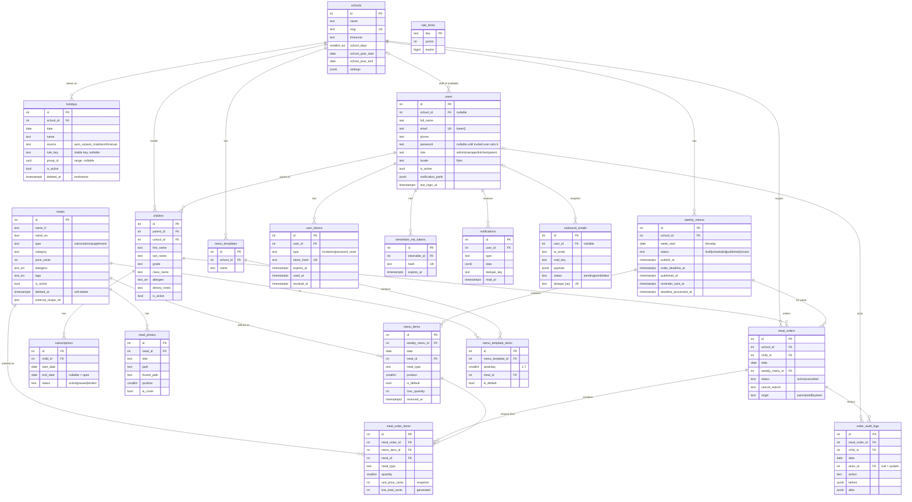

# BFK School Meals — database schema (ERD)

PostgreSQL 16+ (any currently supported major). Written in Phase 0; each phase creates its own tables (see `docs/PLAN.md`). Changing this file after Phase 1 requires a new migration — never edit an applied migration.

## 0. Global conventions and decisions

| Topic | Decision | Why |
|---|---|---|
| Primary keys | `id integer generated by default as identity` (Lucid `table.increments('id')`) | pg returns `int8` as **strings**; int4 keeps ids as JS numbers and is plenty for this volume. |
| Naming | snake_case tables/columns; camelCase in models (Lucid default naming strategy) | brief §2 |
| Timestamps | `created_at`, `updated_at` are `timestamptz not null default now()` | instants are stored in UTC, displayed in Africa/Casablanca |
| Business days | `date` columns, read as `'YYYY-MM-DD'` strings (pg type parser OID 1082, see STACK_NOTES §2) | golden rule 2 |
| Times of day in settings | `'HH:mm'` strings, interpreted in the school's IANA zone | Morocco's offset changes (Ramadan), never store offsets |
| **Enums** | **`text` + `CHECK (col IN (...))`**, never PostgreSQL `CREATE TYPE ... AS ENUM` | adding a value to a PG enum can't run inside a transaction on older majors and can't be removed; a check constraint is changed with one `ALTER TABLE` in a normal migration. TypeScript string unions mirror each check in `app/enums/*.ts`. |
| **Money** | **integer centimes** in columns named `*_cents` (`integer`, `CHECK >= 0`). 12.50 MAD = `1250` | exact integer arithmetic in JS (no float, no decimal library, no pg `numeric`→string conversion); formatting via one `formatMad(cents, locale)` helper. Max 21,474,836.47 MAD per value — enough. |
| **Allergens** | `text[]` with `CHECK (col <@ ARRAY[...14 codes...]::text[])` on both `children.allergies` and `meals.allergens` (brief proposed jsonb) | the DB itself rejects unknown codes; the overlap operator `child.allergies && meal.allergens` powers the allergy sheet and the order check in one SQL expression; GIN-indexable. |
| Free lists (tags) | `text[]` | same reasons, no check (tags list lives in `config/meals.ts`) |
| Soft delete | only `meals` (and `holidays` tombstones, `menu_items.removed_at`) — see those sections | golden rule 7 |
| FKs | explicit `ON DELETE`; business rows referenced by orders use `RESTRICT` | history must survive |
| Multi-school | `school_id` on `children`, `holidays`, `weekly_menus`, `menu_templates`, `meal_orders`. **Meals are a BFK-wide catalog (no `school_id`)**: BFK cooks for schools, the same dish can be served to several. | brief §4 "keep school_id"; catalog sharing is the natural model for a restaurant |
| Guardians (D8) | `children.parent_id` (one parent). All "can this user see this child" checks go through one query scope `Child.visibleTo(user)` and one policy, so switching to a `child_guardians(child_id, user_id)` pivot later changes two places + one migration. | D8 default, alternative kept easy |

### Allergen codes (EU 14) — `app/enums/allergens.ts` (Phase 2: `ALLERGENS`, `ALLERGENS_SQL_ARRAY`), mirrored in the check constraints
`gluten, crustaceans, eggs, fish, peanuts, soybeans, milk, nuts, celery, mustard, sesame, sulphites, lupin, molluscs`
Labels (FR/EN) live in `resources/lang/*/allergens.json`. SQL literal used by both checks:
```sql
ARRAY['gluten','crustaceans','eggs','fish','peanuts','soybeans','milk','nuts','celery','mustard','sesame','sulphites','lupin','molluscs']::text[]
```

---

## 1. Diagram



---

## 2. Tables

Format: `column — type — null? — default — notes`. "NN" = `NOT NULL`.

### schools — Phase 1
| Column | Type | Null | Default | Notes |
|---|---|---|---|---|
| id | integer identity | NN | | PK |
| name | text | NN | | "Britech School" |
| slug | text | NN | | UNIQUE |
| timezone | text | NN | `'Africa/Casablanca'` | IANA name; validated with Luxon `IANAZone.isValidZone` in the app |
| school_days | smallint[] | NN | `'{1,2,3,4,5}'` | ISO weekdays (1 = Mon). CHECK `school_days <@ '{1,2,3,4,5,6,7}' AND cardinality(school_days) > 0` |
| school_year_start | date | NN | | |
| school_year_end | date | NN | | CHECK `school_year_end > school_year_start` |
| settings | jsonb | NN | defaults below | CHECK `jsonb_typeof(settings) = 'object'` |
| created_at / updated_at | timestamptz | NN | now() | |

`school_days` and the school year are real columns (queried by SQL); all other §6 settings live in `settings`. The app reads settings through `SchoolSettingsService.get(school)`, which **deep-merges stored JSON over code defaults** (so a new key never needs a data migration) and validates writes with a VineJS schema.

#### `settings` keys (brief §6; defaults from `docs/DECISIONS.md`)
| Key | Type | Default | Source |
|---|---|---|---|
| `publish_weekday` | int 1–7 (ISO), weekday **of the week before** `week_start` | `4` (Thursday) | D3 |
| `publish_time` | `'HH:mm'` | `'10:00'` | D3 |
| `deadline_weekday` | int 1–7, weekday of the week before | `7` (Sunday) | D4 |
| `deadline_time` | `'HH:mm'` | `'20:00'` | D4 |
| `reminder_hours_before_deadline` | int 1–168 | `24` | **no decision yet — proposed, see PLAN "decisions to confirm"** |
| `allow_parent_edits` | boolean | `true` | D5 |
| `edit_mode` | `'until_cutoff' \| 'same_day_only'` | `'until_cutoff'` | D5 |
| `edit_cutoff_days_before` | int 0–7 | `1` | D5 |
| `edit_cutoff_time` | `'HH:mm'` | `'18:00'` | D5 |
| `auto_assign_default_meal` | boolean | `true` | D10 |
| `allergy_rule` | `'block' \| 'warn_confirm'` | `'block'` | D9 |
| `generate_moroccan_holidays` | boolean | `false` | D6 |
| `ics_calendar_url` | string (https) \| null | `null` | D7 |
| `email_notifications` | object of booleans: `enabled`, `menu_published`, `deadline_reminder`, `holiday_cancellation`, `order_changed_by_staff`, `menu_change` | all `true` | brief §6 "notification emails on/off" (master switch + per type) |
| `subscription_required_for_main_meal` | boolean | `true` | D2 (false = pay-per-meal for unsubscribed children) |
| `supplement_max_quantity` | int 1–20 | `5` | Phase 6 rule "quantity 1–5" |
| `label_grid` | `{ cols: int, rows: int }` | `{ "cols": 3, "rows": 8 }` | Phase 7 |

Default `publish_at` for a week = `(week_start − 7 days + (publish_weekday − 1) days)` at `publish_time` in the school zone → Thursday 10:00 before. Same formula for `order_deadline_at`.

### users — Phase 1
| Column | Type | Null | Default | Notes |
|---|---|---|---|---|
| id | integer identity | NN | | |
| school_id | integer | null | | FK → schools ON DELETE SET NULL. Phase 2: **required (app-level) for parents** — children get the parent's school. Staff: only Phase 1 `SchoolPolicy` treats `null` as all schools; Phase 2+ policies require staff to have a school and never treat `null` as "all". |
| full_name | text | NN | | |
| email | text | NN | | stored lower-cased by the model; **UNIQUE INDEX on `lower(email)`** |
| phone | text | null | | E.164 when possible |
| password | text | **null** | | null until the invited user sets it (hash via `@adonisjs/core` hash, argon2/scrypt per kit config) |
| role | text | NN | `'parent'` | CHECK `IN ('admin','manager','kitchen','parent')` |
| locale | text | NN | `'fr'` | CHECK `IN ('fr','en')` |
| is_active | boolean | NN | `true` | inactive users can't log in; checked on every request |
| notification_prefs | jsonb | NN | `'{}'` | per-parent email opt-outs, e.g. `{ "deadline_reminder": false }`. Phase 8: only `menu_published` and `deadline_reminder` can be turned off (`OPT_OUTABLE_EMAILS`); holiday cancellations, menu changes and staff changes are always emailed (other stored keys are ignored). Checked when queuing **and** when sending. In-app notifications are never turned off. |
| invited_at | timestamptz | null | | last invitation sent (list column "invited") |
| last_login_at | timestamptz | null | | "never logged in" filter |
| credentials_version | integer | NN | `0` | **added in Phase 2** (security follow-up). Bumped by the User model when the password or email changes or the account is deactivated; sessions (`auth_cv` session key) and the `bfk_kd` known-device cookie are bound to it. |
| created_at / updated_at | timestamptz | NN | now() | |

Indexes: `users_email_lower_unique (lower(email))`, `(role, is_active)`, trigram/`ILIKE` search on name/email/phone is a seq scan at this size — fine (a `pg_trgm` GIN index can be added in Phase 9 if needed).

### remember_me_tokens — Phase 1 (created by `@adonisjs/auth` session guard)
Shape as generated by the auth package's migration (`tokenable_id` → users ON DELETE CASCADE, `hash` UNIQUE, `expires_at`, timestamps). Not designed here — use the stub the package generates.

### rate_limits — Phase 1 (created by `@adonisjs/limiter`, database store)
Use the migration generated by `node ace add @adonisjs/limiter` (store = database). Not designed here.

### user_tokens — Phase 2 (invitations + password resets)
| Column | Type | Null | Default | Notes |
|---|---|---|---|---|
| id | integer identity | NN | | |
| user_id | integer | NN | | FK → users ON DELETE CASCADE |
| type | text | NN | | CHECK `IN ('invitation','password_reset')` |
| token_hash | text | NN | | **SHA-256 hex of a 32-byte random token** (`crypto.randomBytes(32).toString('base64url')`). UNIQUE. The raw token only exists in the email link. |
| expires_at | timestamptz | NN | | invitation = created + 72 h; reset = created + 60 min (proposed) |
| used_at | timestamptz | null | | set when consumed → single use |
| revoked_at | timestamptz | null | | set on all older tokens of the same (user, type) when a new one is issued ("resend invalidates the previous one") |
| created_by | integer | null | | FK → users ON DELETE SET NULL (staff who sent the invitation) |
| request_ip | inet | null | | for resets |
| created_at | timestamptz | NN | now() | |

Indexes: UNIQUE `token_hash`; **UNIQUE** `(user_id, type) WHERE used_at IS NULL AND revoked_at IS NULL` (`user_tokens_one_open_per_type`, Phase 2 fix: at most one open link per user and type; `issue()` also locks the user row).
Lookup: hash the presented token, `SELECT ... WHERE token_hash = $1 AND used_at IS NULL AND revoked_at IS NULL AND expires_at > now() FOR UPDATE`, then set `used_at` in the same transaction. Hashing makes a leaked DB dump useless; a DB row (not just a signed URL) is what makes "single use" and "resend revokes" possible — the brief's "signed link" is implemented as this random-token link.
Invitation status shown in the parents list is derived: `password IS NOT NULL` → "active"; else latest invitation token → "invited (expires …)" / "expired"; none → "not invited".

### children — Phase 2
| Column | Type | Null | Default | Notes |
|---|---|---|---|---|
| id | integer identity | NN | | |
| parent_id | integer | NN | | FK → users ON DELETE RESTRICT (a parent with children is deactivated, not deleted). App check: the user's role is `parent`. |
| school_id | integer | NN | | FK → schools ON DELETE RESTRICT. Phase 9: composite FK `children_parent_school_fk` (parent_id, school_id) → users (id, school_id) (with `users_id_school_id_unique`): a child always has its parent's school; moving a parent with children to another school is refused. |
| first_name | text | NN | | |
| last_name | text | NN | | |
| grade | text | null | | e.g. "G3", "KG2" — free text, kept as text for the school's own labels |
| class_name | text | null | | e.g. "3B" |
| allergies | text[] | NN | `'{}'` | CHECK `allergies <@ ARRAY[EU-14]::text[]` |
| dietary_notes | text | null | | free text (shown on the allergy sheet) |
| is_active | boolean | NN | `true` | |
| created_at / updated_at | timestamptz | NN | now() | |

Indexes: `(parent_id)`; `(school_id, is_active)`; `(school_id, grade, class_name)` for production breakdowns; **UNIQUE `(parent_id, lower(first_name), lower(last_name))`** — CSV re-import matches on it (Phase 2). GIN on `allergies` not needed at this size.
Deletion: a child with orders can't be deleted (FK from `meal_orders` RESTRICT) → deactivate.

### subscriptions — Phase 2
| Column | Type | Null | Default | Notes |
|---|---|---|---|---|
| id | integer identity | NN | | |
| child_id | integer | NN | | FK → children ON DELETE CASCADE |
| start_date | date | NN | | |
| end_date | date | null | | null = open-ended. CHECK `end_date IS NULL OR end_date >= start_date` |
| status | text | NN | `'active'` | CHECK `IN ('active','paused','ended')` |
| notes | text | null | | |
| created_at / updated_at | timestamptz | NN | now() | |

Non-overlap: `EXCLUDE USING gist (child_id WITH =, daterange(start_date, end_date, '[]') WITH &&)` (needs `CREATE EXTENSION IF NOT EXISTS btree_gist`). If the host forbids the extension, drop the constraint and keep the app-level check done under `SELECT ... FROM children WHERE id = $1 FOR UPDATE`. A `daterange` with null upper bound is unbounded, as wanted.
"Subscription covers date D" = `status = 'active' AND start_date <= D AND (end_date IS NULL OR end_date >= D)`. A `paused` period covers nothing. Index `(child_id, start_date)`.
Ready for payments later: a future `invoices`/`payments` pair can reference `subscriptions` and `meal_orders` without changing them.

### meals — Phase 3
| Column | Type | Null | Default | Notes |
|---|---|---|---|---|
| id | integer identity | NN | | |
| name_fr / name_en | text | NN | | |
| description_fr / description_en | text | null | | |
| type | text | NN | | CHECK `IN ('subscription','supplement')`. Can't be changed once the meal is on any menu (app rule; `menu_items.meal_type` copies it). |
| category | text | NN | | CHECK `IN ('main','starter','dessert','drink','snack')` |
| price_cents | integer | NN | `0` | **D31:** CHECK `(type = 'subscription' AND price_cents = 0) OR (type = 'supplement' AND price_cents > 0)` (migration `1794000000000`). Subscription meals are free (no price, never charged); a supplement's current price, which orders snapshot. |
| allergens | text[] | NN | `'{}'` | CHECK `allergens <@ ARRAY[EU-14]::text[]` |
| tags | text[] | NN | `'{}'` | e.g. `vegetarian`, `vegan`, `halal`, `spicy`, `gluten_free` (list in `config/meals.ts`) |
| is_active | boolean | NN | `true` | inactive = not offered in new menus, still visible in history |
| external_recipe_ref | text | null | | future link to BFK's central platform |
| created_by | integer | null | | FK → users ON DELETE SET NULL |
| deleted_at | timestamptz | null | | **soft delete** |
| created_at / updated_at | timestamptz | NN | now() | |

**Soft-delete approach:** "Delete" in the back-office always sets `deleted_at` (and `is_active = false`); there is no hard delete in the app. No global `beforeFind` hook (it would hide deleted meals from order history and statements, which must still show them); instead explicit scopes `Meal.query().apply(s => s.catalog())` (= `deleted_at IS NULL`) used by the catalog and menu builder, and nothing on joins from orders. FKs from `menu_items`, `menu_template_items`, `meal_order_items` are `RESTRICT`, so even raw SQL can't remove a used meal. (The community soft-delete package is not v7-compatible — STACK_NOTES §2.)
Indexes: `(type, category) WHERE deleted_at IS NULL`, `(is_active) WHERE deleted_at IS NULL`.
Phase 3 additions: CHECK `deleted_at IS NULL OR NOT is_active` (a deleted meal is never active), CHECK `length(btrim(name_fr|name_en)) > 0`. D31: the meal form has no price for a subscription meal (whatever is posted is dropped; `MealService` stores 0) and requires one (> 0) for a supplement; the DB CHECK enforces the same rule. Photos of a soft-deleted meal are kept (rows and files) for history; they can no longer be changed.

### meal_photos — Phase 3
| Column | Type | Null | Default | Notes |
|---|---|---|---|---|
| id | integer identity | NN | | |
| meal_id | integer | NN | | FK → meals ON DELETE CASCADE |
| disk | text | NN | `'fs'` | Drive disk name, so dev (fs) and prod (s3) rows coexist after a migration |
| path | text | NN | | e.g. `meals/12/<uuid>.webp` (original re-encoded, max 1600 px) |
| thumb_path | text | NN | | e.g. `meals/12/<uuid>_thumb.webp` (400 px) |
| position | smallint | NN | `0` | ordering; not unique (reordering rewrites all positions in one transaction) |
| is_cover | boolean | NN | `false` | partial UNIQUE `(meal_id) WHERE is_cover` → at most one cover |
| width / height | integer | null | | |
| size_bytes | integer | null | | |
| created_at / updated_at | timestamptz | NN | now() | |

Index `(meal_id, position)`. Deleting a photo row deletes both files (after commit).
Phase 3 additions: UNIQUE `path`, UNIQUE `thumb_path`, CHECK `position >= 0`, CHECK width/height/size_bytes > 0 when set. Keys are random UUIDs (never the client's file name); the browser only sees `/media/meal-photos/<id>/<full|thumb>`.

### holidays — Phase 4
| Column | Type | Null | Default | Notes |
|---|---|---|---|---|
| id | integer identity | NN | | |
| school_id | integer | NN | | FK → schools ON DELETE CASCADE |
| date | date | NN | | one row per closed school day |
| name | text | NN | | (single language; the admin types it, generators use the FR name from config — can add `name_en` later if parents must see it in EN) |
| source | text | NN | | CHECK `IN ('auto_us','auto_ma','import','manual')` |
| rule_key | text | null | | **stable idempotency key** for generated/imported rows, e.g. `us_thanksgiving_2026`, `us_thanksgiving_friday_2026`, `ma_throne_day_2027`, `ics:<UID>:2026-12-21`. Null for manual rows. |
| group_id | uuid | null | | **range grouping**: all rows of "Winter break" share one `group_id` (`crypto.randomUUID()`); edit/delete act on the group |
| is_active | boolean | NN | `true` | "disabled": still listed (greyed) but not a holiday |
| deleted_at | timestamptz | null | | **tombstone**: "deleted" generated/imported rows stay hidden in the table so they are never re-created |
| created_by | integer | null | | FK → users ON DELETE SET NULL |
| created_at / updated_at | timestamptz | NN | now() | |

Constraints / indexes:
- UNIQUE `(school_id, rule_key)` (rule_key null rows are not compared) — the generator does `INSERT ... ON CONFLICT (school_id, rule_key) DO NOTHING`. Because disabled (`is_active = false`) and deleted (`deleted_at` set) rows keep their `rule_key`, a re-run never brings them back. **Manual rows are hard-deleted** (no rule_key → nothing to remember).
- Partial UNIQUE `(school_id, date, name) WHERE deleted_at IS NULL` (refines brief's unique(school_id, date, name) so a tombstone doesn't block re-adding by hand).
- Hot path: partial index `(school_id, date) WHERE is_active AND deleted_at IS NULL` → `isHoliday`, `holidaysBetween`.
- Index `(school_id, group_id) WHERE group_id IS NOT NULL`.
- CHECK `source NOT IN ('auto_us','auto_ma') OR rule_key IS NOT NULL` (generated rows always carry a key; imports usually do, manual rows don't).

Phase 4 additions: CHECK `length(btrim(name)) BETWEEN 1 AND 120`, CHECK `rule_key` length 1–200, index `(school_id, date) WHERE deleted_at IS NULL` (calendar/list screens, which also show disabled rows). Imported rule keys are `ics:<first 24 hex of sha256(UID)>:<date>` (the raw UID is never stored). Ranges are stored only for school days (weekday in `school_days` and inside the school year).

"Is D a holiday" = `EXISTS (... WHERE school_id = ? AND date = D AND is_active AND deleted_at IS NULL)`. Several holidays on one date are allowed.

### weekly_menus — Phase 5
| Column | Type | Null | Default | Notes |
|---|---|---|---|---|
| id | integer identity | NN | | |
| school_id | integer | NN | | FK → schools ON DELETE CASCADE |
| week_start | date | NN | | Monday. CHECK `extract(isodow from week_start) = 1`. UNIQUE `(school_id, week_start)` |
| status | text | NN | `'draft'` | CHECK `IN ('draft','scheduled','published','closed')` |
| publish_at | timestamptz | null | | pre-filled from settings |
| order_deadline_at | timestamptz | null | | CHECK `order_deadline_at IS NULL OR publish_at IS NULL OR order_deadline_at > publish_at` |
| published_at | timestamptz | null | | set once when published (idempotency of the publish job) |
| closed_at | timestamptz | null | | |
| reminder_sent_at | timestamptz | null | | idempotency of `menus:send-reminders` |
| deadline_processed_at | timestamptz | null | | idempotency of `menus:apply-deadline` |
| notes | text | null | | |
| created_by / updated_by | integer | null | | FK → users ON DELETE SET NULL |
| created_at / updated_at | timestamptz | NN | now() | |

Phase 6 addition (D19): `late_publish_warned_at timestamptz null` — the publish job never publishes a menu whose `order_deadline_at` has passed; it leaves it `scheduled` and logs one warning, remembered here (reset when staff change the times).
CHECK `status IN ('draft') OR (publish_at IS NOT NULL AND order_deadline_at IS NOT NULL)`; CHECK `status NOT IN ('published','closed') OR published_at IS NOT NULL`.
Indexes: UNIQUE `(school_id, week_start)`; `(status, publish_at) WHERE status = 'scheduled'` (publish job); `(status, order_deadline_at) WHERE status = 'published'` (reminder/deadline jobs).
Phase 5 additions: CHECK `notes` ≤ 2000 chars. App rules (MenuCalendar/MenuStatusService): the deadline is also before the end of the menu's week (Monday + 7 days 00:00, school zone); publish/deadline are editable while `draft`/`scheduled` only.
Deleting a menu: only drafts with no orders (FK from `meal_orders` RESTRICT enforces it).

### menu_items — Phase 5
| Column | Type | Null | Default | Notes |
|---|---|---|---|---|
| id | integer identity | NN | | |
| weekly_menu_id | integer | NN | | FK → weekly_menus ON DELETE CASCADE |
| date | date | NN | | must be inside the menu's week and a school day, not a holiday (app check in `MenuBuilderService`) |
| meal_id | integer | NN | | FK → meals ON DELETE RESTRICT |
| meal_type | text | NN | | copy of `meals.type` at insert; CHECK `IN ('subscription','supplement')` — needed for the constraints below |
| position | smallint | NN | `0` | |
| is_default | boolean | NN | `false` | CHECK `NOT is_default OR meal_type = 'subscription'` |
| max_quantity | integer | null | | CHECK `max_quantity IS NULL OR max_quantity > 0` |
| removed_at | timestamptz | null | | removing an item **that has order items** (Phase 6 flow) sets this instead of deleting; items without any order item are hard-deleted |
| created_at / updated_at | timestamptz | NN | now() | |

Constraints / indexes:
- partial UNIQUE `(weekly_menu_id, date, meal_id) WHERE removed_at IS NULL`;
- partial UNIQUE `(weekly_menu_id, date) WHERE is_default AND removed_at IS NULL` → at most one default per day ("exactly one when the day has subscription meals" is checked by the app when scheduling);
- **hot:** `(weekly_menu_id, date)`; `(date)` for kitchen/date lookups; `(meal_id)`.
- Phase 5 additions: CHECK `position >= 0`. Removing an item in Phase 5 = hard delete (no order items exist yet).
- Phase 6 (D18): on a published menu, removing an item with active orders requires a resolution (switch to another item of the same day/type, or remove the line; empty orders are cancelled `menu_change`); afterwards the item gets `removed_at` when order lines still reference it, else it is deleted. `max_quantity` can't go below the portions in active orders; the default can change only before the order deadline.

### menu_templates — Phase 5
| Column | Type | Null | Default | Notes |
|---|---|---|---|---|
| id | integer identity | NN | | |
| school_id | integer | NN | | FK → schools ON DELETE CASCADE |
| name | text | NN | | UNIQUE `(school_id, lower(name))` |
| description | text | null | | |
| created_by | integer | null | | FK → users ON DELETE SET NULL |
| created_at / updated_at | timestamptz | NN | now() | |

### menu_template_items — Phase 5
| Column | Type | Null | Default | Notes |
|---|---|---|---|---|
| id | integer identity | NN | | |
| menu_template_id | integer | NN | | FK → menu_templates ON DELETE CASCADE |
| weekday | smallint | NN | | ISO 1–7, CHECK `BETWEEN 1 AND 7` |
| meal_id | integer | NN | | FK → meals ON DELETE RESTRICT (deleted/inactive meals are skipped when applying) |
| meal_type | text | NN | | copy, CHECK as in menu_items |
| position | smallint | NN | `0` | |
| is_default | boolean | NN | `false` | CHECK `NOT is_default OR meal_type = 'subscription'` |
| max_quantity | integer | null | | |

UNIQUE `(menu_template_id, weekday, meal_id)`; partial UNIQUE `(menu_template_id, weekday) WHERE is_default`.
Phase 5 additions: CHECK `max_quantity IS NULL OR max_quantity > 0`, `position >= 0`; `menu_templates`: CHECK name 1–120 chars (trimmed), description ≤ 500; index `(meal_id)` on items.

### notifications — Phase 5 (table + `notify()`), UI in Phase 8 (`/notifications`, `NotificationCenterService`: text rendered at display time with `safeTranslate`, every query filtered on the reader's `user_id`)
| Column | Type | Null | Default | Notes |
|---|---|---|---|---|
| id | integer identity | NN | | |
| user_id | integer | NN | | FK → users ON DELETE CASCADE |
| type | text | NN | | CHECK `IN ('menu_published','deadline_reminder','holiday_cancellation','order_changed_by_staff','menu_change','auto_assigned')` |
| data | jsonb | NN | `'{}'` | ids + params for the i18n message; text is rendered at display time in the user's locale |
| dedupe_key | text | null | | e.g. `menu_published:42`. Partial UNIQUE `(user_id, dedupe_key) WHERE dedupe_key IS NOT NULL` → jobs can re-run safely |
| read_at | timestamptz | null | | |
| created_at | timestamptz | NN | now() | |

Indexes: `(user_id, created_at DESC)`; `(user_id) WHERE read_at IS NULL` (unread badge).
Phase 5 additions: CHECK `jsonb_typeof(data) = 'object'`, `dedupe_key` 1–200 chars. `created_at` is written from `Clock`.

### outbound_emails — Phase 5 (with the first bulk email); used by Phases 2, 6, 8 (addition to the brief)
| Column | Type | Null | Default | Notes |
|---|---|---|---|---|
| id | integer identity | NN | | |
| user_id | integer | null | | FK → users ON DELETE SET NULL |
| to_email | text | NN | | |
| locale | text | NN | `'fr'` | CHECK `IN ('fr','en')` |
| mail_key | text | NN | | which mail class, e.g. `menu_published` |
| payload | jsonb | NN | `'{}'` | ids only; the mail class reloads data when sending |
| status | text | NN | `'pending'` | CHECK `IN ('pending','sending','sent','failed')` |
| attempts | smallint | NN | `0` | max 5, then `failed` |
| last_error | text | null | | |
| send_after | timestamptz | NN | now() | backoff |
| sent_at | timestamptz | null | | |
| dedupe_key | text | null | | partial UNIQUE `WHERE dedupe_key IS NOT NULL`, e.g. `reminder:42:user:7` |
| created_at / updated_at | timestamptz | NN | now() | |

Index `(status, send_after) WHERE status IN ('pending','sending')`. `mail:dispatch` picks rows with `FOR UPDATE SKIP LOCKED`.
Phase 5 additions: CHECK `mail_key ~ '^[a-z0-9_]{1,60}$'`, `jsonb_typeof(payload) = 'object'`, `status <> 'sent' OR sent_at IS NOT NULL`, `attempts` 0–100, `dedupe_key` 1–200 chars; index `(sent_at) WHERE sent_at IS NOT NULL` (rolling hourly cap). `send_after`/`sent_at`/`updated_at` are written from `Clock`. Skipped rows (recipient deactivated, menu gone, unknown key) end `failed` with `last_error = 'skipped: <reason>'`. Why: `mail.sendLater` is in-memory (lost on restart) and `@adonisjs/queue` is experimental — see STACK_NOTES §5/§7. **Exception — invitation and password-reset mails bypass the outbox**: the raw token must never be persisted, so they are sent directly with `mail.send` right after the token's transaction commits; a failure is logged and the admin (or parent) uses "resend" / asks again.

### meal_orders — Phase 6
| Column | Type | Null | Default | Notes |
|---|---|---|---|---|
| id | integer identity | NN | | |
| school_id | integer | NN | | FK → schools ON DELETE RESTRICT (copy of the child's school, for reports) |
| child_id | integer | NN | | FK → children ON DELETE RESTRICT |
| date | date | NN | | **UNIQUE `(child_id, date)`** |
| weekly_menu_id | integer | NN | | FK → weekly_menus ON DELETE RESTRICT |
| status | text | NN | `'active'` | CHECK `IN ('active','cancelled')` |
| cancel_reason | text | null | | CHECK `IN ('absent','holiday','menu_change','staff','child_inactive','subscription_ended')` (`subscription_ended` added in the Phase 6 review); CHECK `(status = 'cancelled') = (cancel_reason IS NOT NULL)` |
| cancel_note | text | null | | free text from staff |
| cancelled_at | timestamptz | null | | |
| origin | text | NN | | CHECK `IN ('parent','staff','system')` — who created it (system = deadline auto-assign) |
| created_by / updated_by | integer | null | | FK → users ON DELETE SET NULL; null = system |
| created_at / updated_at | timestamptz | NN | now() | |

Semantics: **no row** = "no selection yet"; **cancelled row with reason `absent`** = parent chose "no meal this day" → the deadline auto-assign skips it and "children without a selection" doesn't count it.
Re-activating a cancelled day updates the same row (status back to `active`), audited.
Indexes (hot): UNIQUE `(child_id, date)` (also serves "by child + date range"); `(date, status)` (kitchen/dashboard by date); `(weekly_menu_id, status)` (reminder/deadline jobs, menu impact); `(school_id, date)`.

### meal_order_items — Phase 6
| Column | Type | Null | Default | Notes |
|---|---|---|---|---|
| id | integer identity | NN | | |
| meal_order_id | integer | NN | | FK → meal_orders ON DELETE CASCADE (orders themselves are never deleted) |
| menu_item_id | integer | NN | | FK → menu_items ON DELETE RESTRICT |
| meal_id | integer | NN | | FK → meals ON DELETE RESTRICT (copy, so reports don't need the menu join) |
| meal_type | text | NN | | snapshot, CHECK `IN ('subscription','supplement')` |
| quantity | smallint | NN | `1` | CHECK `quantity BETWEEN 1 AND 20`; CHECK `meal_type = 'supplement' OR quantity = 1` |
| unit_price_cents | integer | NN | | **price snapshot at order time**, CHECK `>= 0`. D31: subscription lines snapshot 0 (older lines may hold a pre-D31 price — kept as history, never billed) |
| line_total_cents | integer | NN | generated | `GENERATED ALWAYS AS (quantity * unit_price_cents) STORED` |
| created_at / updated_at | timestamptz | NN | now() | |

Constraints / indexes: UNIQUE `(meal_order_id, menu_item_id)`; partial UNIQUE `(meal_order_id) WHERE meal_type = 'subscription'` → **max one subscription meal per child per day at DB level**; `(menu_item_id)` (max_quantity counts, menu impact); `(meal_id)`.
Saving a day: inside the transaction, lock the order row (or the child row when none exists yet), diff items (update quantity / insert / delete), keep the snapshot price of unchanged items, snapshot the current price for new ones. `max_quantity` is checked with `SELECT ... FROM menu_items WHERE id = ? FOR UPDATE` then `SUM(quantity)` over active orders.

### order_audit_logs — Phase 6
| Column | Type | Null | Default | Notes |
|---|---|---|---|---|
| id | integer identity | NN | | |
| meal_order_id | integer | NN | | FK → meal_orders ON DELETE RESTRICT |
| child_id | integer | NN | | copy, for "history of this child" |
| date | date | NN | | copy |
| actor_id | integer | null | | FK → users ON DELETE SET NULL; null = system |
| actor_role | text | NN | | CHECK `IN ('parent','admin','manager','system')` (role at the time) |
| action | text | NN | | CHECK `IN ('create','update','cancel','reactivate','auto_assign','holiday_cancel','menu_change_switch','menu_change_cancel','staff_override')` |
| reason | text | null | | required for staff overrides (app rule) |
| before | jsonb | null | | `{ status, items: [{ menuItemId, mealId, qty, unitPriceCents }] }`; null on create |
| after | jsonb | null | | same shape |
| ip_address | inet | null | | |
| created_at | timestamptz | NN | now() | append-only: no `updated_at`, the model never updates/deletes |

Indexes: `(meal_order_id, created_at)`; `(child_id, date)`; `(created_at)`.
Phase 6 additions: CHECK `actor_role <> 'system' OR actor_id IS NULL`, `reason` ≤ 500 chars, `before`/`after` are jsonb objects. `meal_orders`: CHECK `status = 'active' OR cancelled_at IS NOT NULL`, `cancel_note` ≤ 500. Phase 6 review: deactivating a child or parent cancels the child's orders dated **after today** (`child_inactive`, audited `staff_override` as the staff member, reason `child_inactive`; today's order is kept — the kitchen is preparing it); ending/shortening/deleting a subscription removes the subscription-meal line of future orders on uncovered dates (`reason = 'subscription_ended'`), cancelling orders left empty with `cancel_reason = 'subscription_ended'` (migration `1793600000004`; not locked by D24, the parent may re-order). Days cancelled `staff`/`child_inactive` are re-opened by staff only (D24). Staff change dates of the current month or later only (D23). Menu-change switches keep `min(original unit price, new meal price)` (D25). Holiday cancellations only touch orders dated after today (past dates can become holidays for the calendar; their served orders stay) and are audited as the admin who confirmed (`reason = 'holiday'`), or as `system` when the `holidays:generate` command runs without an actor; menu-change switches/cancels as the staff member (`reason` = `menu_item_removed:<itemId>`).

**Lock order (Phase 6, everything that touches orders):** school row (`FOR SHARE` by orders/builder/jobs, `FOR UPDATE` by holiday writes) → weekly menu (`FOR SHARE` by orders, `FOR UPDATE` by the builder, publication and deadline job) → child row `FOR UPDATE` → order rows `FOR UPDATE` → capped menu items `FOR UPDATE` (id order) → meals `FOR SHARE`. So an order can't commit on a date that becomes a holiday, can't interleave with an item removal/default change or the deadline auto-assign, and two orders can't both take the last `max_quantity` portion.

---

## 3. Hot queries → indexes (summary)

| Query | Index |
|---|---|
| orders of a date (kitchen, dashboard) | `meal_orders (date, status)` |
| child's orders for a week | `meal_orders UNIQUE (child_id, date)` |
| items of a menu day | `menu_items (weekly_menu_id, date)` |
| is a date a holiday / holidays in range | `holidays (school_id, date) WHERE is_active AND deleted_at IS NULL` |
| due menus to publish | `weekly_menus (status, publish_at) WHERE status = 'scheduled'` |
| unread notifications | `notifications (user_id) WHERE read_at IS NULL` |
| outbox drain | `outbound_emails (status, send_after)` |

Phase 7 runs `EXPLAIN ANALYZE` on the production/dashboard queries with seed data and adds indexes by migration if needed. **Done (Phase 7): no index needed** — every report query uses the indexes above plus `meal_order_items` UNIQUE `(meal_order_id, menu_item_id)` (timings in STACK_NOTES, Phase 7 surprises).

## 4. Derived (no table)
- **Statements** (Phase 8, `StatementService`; **D31** supersedes D1): computed from `meal_order_items` of `active` orders dated inside the calendar month, grouped by child. **Only supplements are billed**: one line per (meal, snapshot unit price), amounts = sum of their snapshot `line_total_cents` (by PostgreSQL); child total = supplements; family total = sum of the children. **Subscription meals are only counted** ("N repas d'abonnement · inclus"), never priced — including legacy lines snapshotted with a price before D31 (history is not rewritten, it is ignored). Cancelled days (any reason) and days without an order contribute nothing. Months: 2000-01 up to the month after today; the current month (and later) is **provisional**, earlier months are final (D23). The former `billing_mode` / `monthly_fee_cents` settings are removed (D29 obsolete; stale keys in `schools.settings` are ignored and dropped on the next save). The same rule applies to the dashboard month-to-date (supplement amounts + subscription meal count), the parent week/family totals and history, the back-office order list and the kitchen/admin exports (subscription rows have empty amount cells). No payment tracking (D11).
- **Invitation status**: see `user_tokens`.
- **Day state for the parent** (open/locked/holiday/not published): computed by `OrderWindowService`, never stored.
